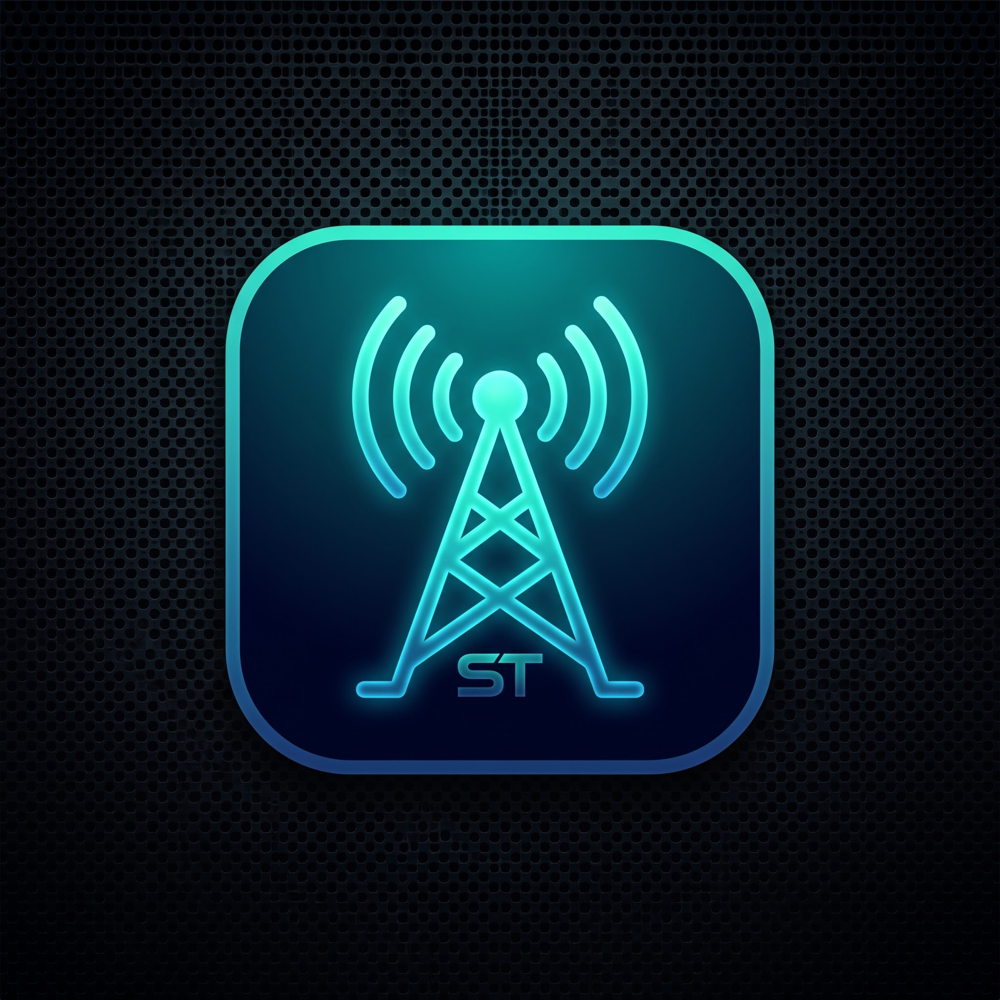

  

# StreamTuner

**StreamTuner** is a lightweight, high-stability IPTV tuner proxy, MPEG-TS stream-repair engine, and multi-region XMLTV EPG aggregator built in Go and packaged with FFmpeg for Unraid and Docker.

It is designed to solve the most common headaches with Free-to-Air (FTA) and international IPTV streams in **Jellyfin**, **Plex**, and **Emby**—specifically stream drops during commercial breaks, massive EPG guide bloat, and disorganized channel lineups.

---

## Key Features

* **MPEG-TS Stream-Repair Proxy:** Intercepts live HLS (`.m3u8`) broadcasts and remuxes them on the fly into continuous MPEG-TS streams (`-c copy` with zero CPU video transcoding). Smooths over ad-break timestamp resets (`#EXT-X-DISCONTINUITY`) so Jellyfin and Plex never crash mid-show.
* **Multi-Region Playlist Ingestion & Auto-Numbering:** Combine multiple M3U playlists from around the world. StreamTuner automatically tags channel names by region and separates them into clean numerical blocks:
  * **Australia (`[AU]`):** Channels `1 – 99`
  * **United States (`[US]`):** Channels `1000 – 1999`
  * **Canada (`[CA]`):** Channels `2000 – 2999`
  * **Japan (`[JP]`):** Channels `3000 – 3999`
  * **United Kingdom (`[UK]`):** Channels `4000 – 4999`
* **Smart XMLTV EPG Aggregator:** Ingests multiple `.xml` and compressed `.xml.gz` guide files, strips out disabled channels to save server RAM, and serves a single unified `/epg.xml` file that automatically refreshes every 12 hours.
* **Dual Tuner Modes:**
  * **HDHomeRun Emulator Mode:** Plug-and-play virtual hardware tuner discovery for Plex, Jellyfin, and Emby.
  * **M3U Category Mode:** Generates a dedicated `/channels.m3u` playlist with native `group-title` tags so Jellyfin and Emby automatically display regional category tabs across the top of the Live TV guide.
* **Custom Channel Overrides:** Inject direct stream URLs, custom channel numbers, and specific EPG IDs directly from the dashboard.
* **Modern Web Dashboard:** Features a Nighttime/Daytime theme toggle, scrollable channel table, editable channel numbers, keyword whitelist filtering, and one-click JSON configuration backup and restore.

---

## Endpoints Reference

Once running, StreamTuner exposes the following endpoints (replace `192.168.0.149:7070` with your server IP and host port):

| Endpoint | Description |
| :--- | :--- |
| `http://192.168.0.149:7070/` | **Web Dashboard** — Configure playlists, tuners, EPGs, and active channels. |
| `http://192.168.0.149:7070/discover.json` | **HDHomeRun Discovery** — Virtual tuner metadata for media servers. |
| `http://192.168.0.149:7070/lineup.json` | **HDHomeRun Lineup** — JSON channel roster of enabled stations. |
| `http://192.168.0.149:7070/channels.m3u` | **M3U Tuner Playlist** — M3U playlist with `group-title` country category tags. |
| `http://192.168.0.149:7070/epg.xml` | **Aggregated EPG** — Filtered XMLTV program guide for enabled stations only. |
| `http://192.168.0.149:7070/stream/{num}` | **Live Stream Proxy** — Direct MPEG-TS remuxed video feed for channel `{num}`. |

---

## Installation

### Unraid (Community Applications / Template)

1. Open the Unraid WebGUI and navigate to the **Apps** or **Docker** tab.
2. Search for **StreamTuner** (`homerj007/streamtuner`).
3. Verify the default mappings:
   * **WebUI & HDHomeRun Port:** `7070` (maps to internal container port `8080`)
   * **AppData Config Path:** `/mnt/user/appdata/streamtuner` (maps to `/config`)
4. Click **Apply** and open the **WebUI**.

### Docker CLI

    docker run -d \
      --name StreamTuner \
      --restart unless-stopped \
      -p 7070:8080 \
      -v /mnt/user/appdata/streamtuner:/config \
      homerj007/streamtuner:latest

---

## Media Server Setup

### Option A: Jellyfin / Emby with Category Tabs (M3U Mode — Recommended)

1. In Jellyfin, go to **Dashboard > Live TV**.
2. Click **+** next to **Tuner Devices** and select **M3U Tuner**.
3. Set **File or URL** to:

    http://YOUR-SERVER-IP:7070/channels.m3u

4. Set **Simultaneous stream limit** to match your Virtual Tuners count (e.g., `4`).
5. Under **TV Guide Data Providers**, click **+** and select **XMLTV**.
6. Set **File or URL** to:

    http://YOUR-SERVER-IP:7070/epg.xml

7. Save and refresh the guide. Your Live TV screen will now include regional category tabs (**Australia**, **United States**, **Canada**, **Japan**).

### Option B: Plex DVR / Standard HDHomeRun Mode

1. In Plex (or Jellyfin), go to **Live TV & DVR** and add a tuner device.
2. Enter your StreamTuner address manually:

    http://YOUR-SERVER-IP:7070

3. When prompted for an XMLTV Guide, enter:

    http://YOUR-SERVER-IP:7070/epg.xml

---

## Custom Direct Channels Format

To manually add or override a station in the **Custom Direct Channels** box, enter one channel per line using the format `Number, Channel Name, Stream URL, EPG_ID`:

    9, Channel 9 HD, https://example.com/live/ch9.m3u8, mjh-channel-9-nsw

---

## Persistent Storage

All configuration settings and aggregated guide data are stored in `/config`:
* `/config/settings.json` — Saved URLs, tuner count, custom channel numbers, and enabled/disabled states.
* `/config/epg.xml` — Cached and filtered XMLTV guide data.

You can also download or restore your configuration directly from the Web Dashboard using the **Download Backup (.json)** and **Restore Backup** buttons.
